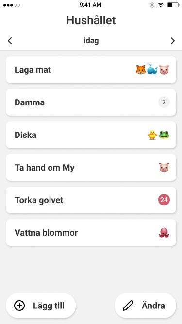
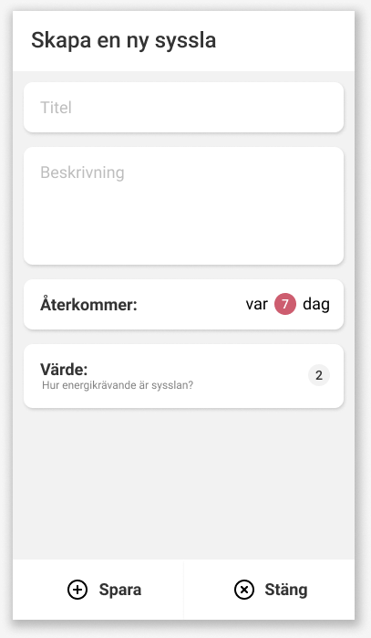
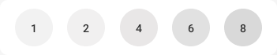
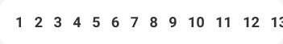
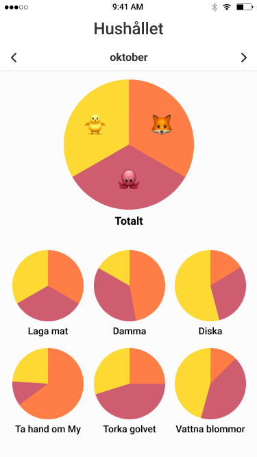
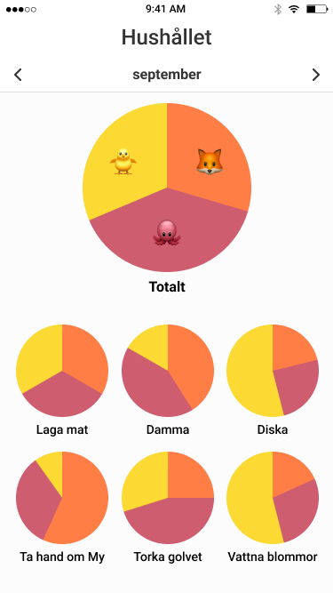
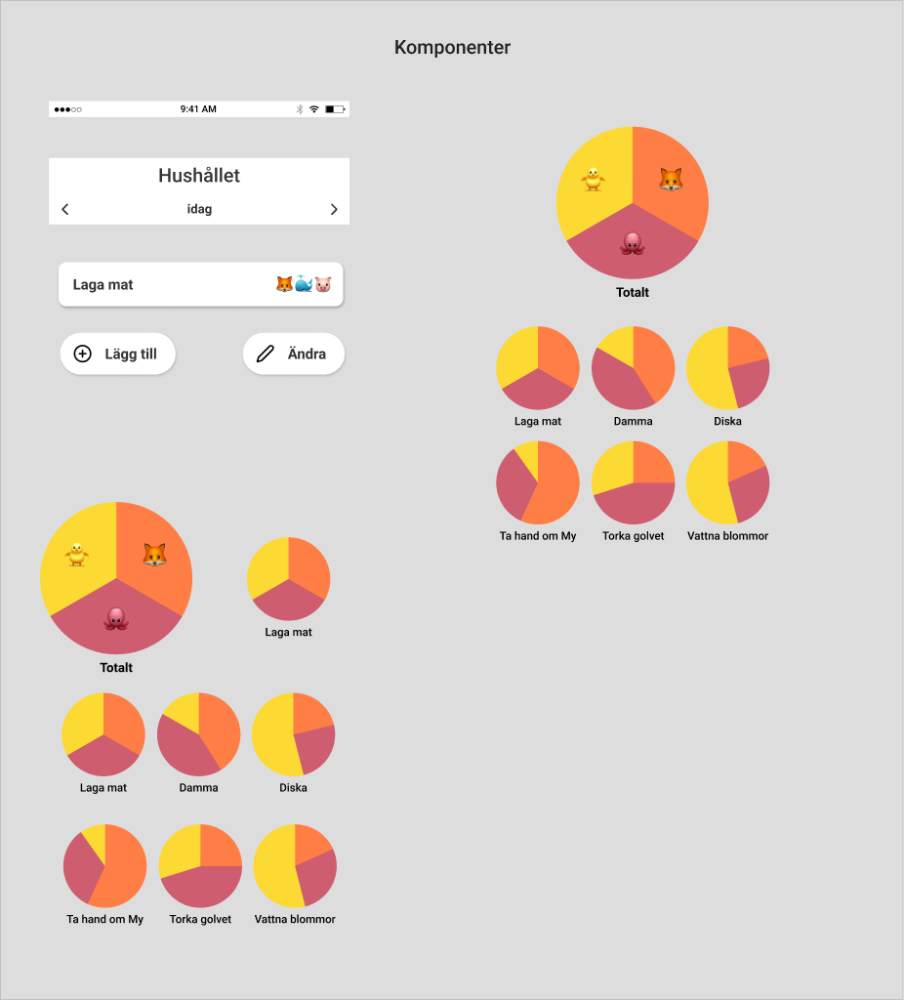

# Design – Hushållet

Källa: Figma-filen [Hushållet](https://www.figma.com/design/wx5SmBt7SZ6v0CHravsYSj/Untitled?node-id=0-1).
Skärmdumpar ligger i [`docs/design/`](design/). Färger och typsnitt finns som kod i [`src/theme/colors.ts`](../src/theme/colors.ts).

Figma-ramarna är ritade för 375 × 667 pt (iPhone 8). Bygg flexibelt (flex, procent) så det fungerar på andra storlekar.

## Innehåll

- [Designsystem](#designsystem)
- [Skärm: Sysslor – idag (Dagsvyn)](#skärm-sysslor--idag-dagsvyn)
- [Skärm: Sysslor – lägg till](#skärm-sysslor--lägg-till)
- [Komponent: Värde väljare](#komponent-värde-väljare)
- [Komponent: Återkommer väljare](#komponent-återkommer-väljare)
- [Skärmar: Statistik](#skärmar-statistik)
- [Komponenter (1:98)](#komponenter-198)
- [Skärmar som saknas i Figma](#skärmar-som-saknas-i-figma)

---

## Designsystem

### Färger

| Token | Hex | Används till |
|---|---|---|
| `background` | `#F2F2F2` | Bakgrund på listskärmar och formulär |
| `surface` | `#FFFFFF` | Kort, knappar, navigationsfält |
| `statsBackground` | `#FCFCFC` | Bakgrund på statistikskärmar |
| `text` | `#333333` | All vanlig text och ikoner |
| `textMuted` | `#828282` | Sekundär text |
| `placeholder` | `#BDBDBD` | Platshållartext i inmatningsfält |
| `badge` | `#F2F2F2` | Grå rund siffer-badge |
| `overdue` | `#CD5D6F` | Röd badge (försenad / valt värde) |
| `onOverdue` | `#FFFFFF` | Text på röd badge |
| Diagram 1–3 | `#FF7E46`, `#CD5D6F`, `#FCD933` | Tårtbitar i statistik (en färg per medlem) |

Skugga på kort och knappar: `1px 2px 2px rgba(0,0,0,0.15)`. Modaler: `rgba(0,0,0,0.25)`.

### Typografi (Roboto)

| Stil | Storlek | Vikt | Används till |
|---|---|---|---|
| Title | 24 | Medium 500 | "Hushållet" i navigationsfältet, modalrubrik |
| Huge | 32 | Medium 500 | Emoji i stora cirkeldiagrammet |
| Subtitle | 16 | Bold 700 | Undertitel ("idag", "förra veckan"), "Totalt" |
| Task Title | 18 | Bold 700 | Namn på syssla, knapptext, etiketter i formulär |
| Task Emoji | 22 | Bold 700 | Avatarer i Task Card |
| Small | 14 | Medium 500 | Siffror i badge, namn under små diagram |
| Caption | 12 | Regular | Hjälptext ("Hur energikrävande är sysslan?") |

Roboto är standard på Android; på iOS går det bra att använda systemtypsnittet eller ladda Roboto via `expo-font`.

### Avstånd och former

- Sidmarginal och avstånd mellan kort: **12 px**.
- Kort: höjd **55 px**, hörnradie **10 px**, inre vänstermarginal **18 px**, högermarginal **13 px**.
- Knappar: höjd **52 px**, helt runda (radie 100), padding 16 px horisontellt, 16 px mellan ikon och text, ikon 24 px.
- Badge: cirkel **24 × 24 px**.
- Ikoner: Feather-ikoner (`plus-circle`, `edit-2`, `x-circle`, `chevron-left`, `chevron-right`) – finns i `@expo/vector-icons/Feather`.

---

## Skärm: Sysslor – idag (Dagsvyn)

Figma: [node 1:8](https://www.figma.com/design/wx5SmBt7SZ6v0CHravsYSj/Untitled?node-id=1-8)

**Layout (uppifrån och ned)**
1. **Statusfält** (systemets, 20 px).
2. **Navigation Bar** (vit): titel "Hushållet" (Title 24) centrerad, under den en rad på 28 px med undertitel "idag" (Subtitle 16) och pilar `chevron-left` / `chevron-right` (24 px) i kanterna, 8 px från kanten. Tunn kantlinje under. Pilarna byter vy (idag → statistik nuvarande vecka → förra veckan → förra månaden).
3. **Innehåll** (bakgrund `#F2F2F2`, padding 12, 12 px mellan kort): en lista med **Task Card**, en per syssla.
4. **Knappar längst ned** (padding 12, `space-between`): "Lägg till" (`plus-circle`) till vänster och "Ändra" (`edit-2`) till höger. Visas bara för ägare.

**Task Card – tre tillstånd** (se även komponenten [1:113](https://www.figma.com/design/wx5SmBt7SZ6v0CHravsYSj/Untitled?node-id=1-113))
| Tillstånd | Höger sida | Exempel |
|---|---|---|
| Gjord (Done) | Avatar-emoji (22 px) för alla som gjort sysslan idag, tätt ihop till höger | "Laga mat 🦊🐳🐷" |
| Öppen (Open) | Grå badge `#F2F2F2` med antal dagar sedan senast, text `#333` 14 px | "Damma (7)" |
| Försenad (Due) | Röd badge `#CD5D6F` med vit siffra | "Torka golvet (24)" |

Tryck på ett kort → detaljvy med beskrivning och en knapp "Markera som gjord".

**Krav:** Dagsvyn 1–3, Profil "avatar används för att visa vad användaren gjort", Sysslor "ägare kan lägga till/redigera".

---

## Skärm: Sysslor – lägg till

Figma: [node 1:21](https://www.figma.com/design/wx5SmBt7SZ6v0CHravsYSj/Untitled?node-id=1-21)

Visas som en **modal** (vit ram med skugga `rgba(0,0,0,0.25)`) över Dagsvyn.

**Layout**
1. Rubrik "Skapa en ny syssla" (Title 24), vänsterställd, vit bakgrund.
2. Innehåll på `#F2F2F2`, padding 12, 12 px mellan fälten:
   - **Titel** – vitt kort 55 px, platshållare "Titel" (`#BDBDBD`, 18 px).
   - **Beskrivning** – vitt kort ~128 px högt, flerradigt, platshållare "Beskrivning".
   - **[Återkommer väljare](#komponent-återkommer-väljare)**.
   - **[Värde väljare](#komponent-värde-väljare)**.
3. Nedre fält (vit, två lika breda knappar med tunn avdelare): "Spara" (`plus-circle`) och "Stäng" (`x-circle`), Task Title 18.

Samma skärm återanvänds för **redigera syssla** (fälten förifyllda, rubrik t.ex. "Ändra syssla"). Bild och ljudinspelning (VG) läggs som extra kort under Värde.

**Krav:** Sysslor 1 (lägga till), 2 (namn, beskrivning, frekvens, vikt), 4 (redigera).

---

## Komponent: Värde väljare

Figma: [node 1:64](https://www.figma.com/design/wx5SmBt7SZ6v0CHravsYSj/Untitled?node-id=1-64)

Vitt kort (351 × 70). I stängt läge: "Värde:" (Task Title 18) + hjälptext "Hur energikrävande är sysslan?" (Caption 12) till vänster och vald vikt som grå badge till höger.
Öppnat läge (som i skärmdumpen): en rad med fem badges **1, 2, 4, 6, 8**. Vald vikt markeras (t.ex. röd `#CD5D6F` med vit text), övriga grå.

**Krav:** Sysslor 2 (vikt). Vikterna används i statistiken.

---

## Komponent: Återkommer väljare

Figma: [node 1:80](https://www.figma.com/design/wx5SmBt7SZ6v0CHravsYSj/Untitled?node-id=1-80)

Vitt kort 351 × 55. "Återkommer:" (Task Title 18) till vänster, till höger "var **[7]** dag" där siffran är en röd badge. Tryck på badgen för att välja antal dagar (t.ex. en horisontell rad/scroll med 1–31, eller +/-).

**Krav:** Sysslor 2 (hur ofta sysslan ska göras, i dagar).

---

## Skärmar: Statistik

| Förra veckan | Oktober | September | 2020 |
|---|---|---|---|
|  |  |  |  |
| [1:82](https://www.figma.com/design/wx5SmBt7SZ6v0CHravsYSj/Untitled?node-id=1-82) | [1:86](https://www.figma.com/design/wx5SmBt7SZ6v0CHravsYSj/Untitled?node-id=1-86) | [1:90](https://www.figma.com/design/wx5SmBt7SZ6v0CHravsYSj/Untitled?node-id=1-90) | [1:94](https://www.figma.com/design/wx5SmBt7SZ6v0CHravsYSj/Untitled?node-id=1-94) |

Alla fyra har samma layout; bara undertiteln i navigationsfältet skiljer sig. Kravlistan kräver **nuvarande vecka**, **förra veckan** och **förra månaden** – använd samma skärm/komponent och byt period. "2020" (år) är frivilligt.

**Layout**
1. Navigation Bar med undertitel = perioden ("förra veckan", "oktober" …) och pilar för att bläddra mellan perioder. Bakgrund `#FCFCFC`.
2. **Pie Chart – Large** ([1:168](https://www.figma.com/design/wx5SmBt7SZ6v0CHravsYSj/Untitled?node-id=1-168)): cirkel **190 px**, centrerad. En tårtbit per medlem, storlek = summan av *vikt* för gjorda sysslor. Medlemmens avatar-emoji (Huge 32) ligger i sin tårtbit. Under: "Totalt" (Subtitle 16, bold).
3. **Chart Row 1 och 2** ([1:186](https://www.figma.com/design/wx5SmBt7SZ6v0CHravsYSj/Untitled?node-id=1-186), [1:190](https://www.figma.com/design/wx5SmBt7SZ6v0CHravsYSj/Untitled?node-id=1-190)): rader med tre **Pie Chart – Small** ([1:179](https://www.figma.com/design/wx5SmBt7SZ6v0CHravsYSj/Untitled?node-id=1-179)) – cirkel **104 px**, padding 8, 6 px till sysslans namn (Small 14) under. Ett diagram per syssla. Fler sysslor → fler rader (scroll).

**Färger:** tårtbitarna använder medlemmens avatarfärg (Figma: `#FF7E46`, `#CD5D6F`, `#FCD933`).

**Tillstånd**
- Ingen statistik för perioden → vyn ska **inte visas** (hoppa över den när man bläddrar).
- Pausad medlem (VG) → deras del normaliseras.

**Tips:** `react-native-svg` + egen arc-beräkning, eller ett bibliotek som `react-native-pie-chart` / `victory-native`.

**Krav:** Statistik 1–6.

---

## Komponenter (1:98)

Figma: [node 1:98](https://www.figma.com/design/wx5SmBt7SZ6v0CHravsYSj/Untitled?node-id=1-98)

| Komponent | Node | Beskrivning |
|---|---|---|
| Button (add) | [1:99](https://www.figma.com/design/wx5SmBt7SZ6v0CHravsYSj/Untitled?node-id=1-99) | Vit rund knapp 52 px, `plus-circle` + "Lägg till" |
| Button (change) | [1:105](https://www.figma.com/design/wx5SmBt7SZ6v0CHravsYSj/Untitled?node-id=1-105) | Vit rund knapp 52 px, `edit-2` + "Ändra" |
| Task Card | [1:113](https://www.figma.com/design/wx5SmBt7SZ6v0CHravsYSj/Untitled?node-id=1-113), [1:129](https://www.figma.com/design/wx5SmBt7SZ6v0CHravsYSj/Untitled?node-id=1-129) | Kort 55 px, varianter Done / Open / Due (se Dagsvyn) |
| Navigation Bar | [1:130](https://www.figma.com/design/wx5SmBt7SZ6v0CHravsYSj/Untitled?node-id=1-130) | Titel + undertitel med pilar, kantlinje under |
| Status Bar | [1:140](https://www.figma.com/design/wx5SmBt7SZ6v0CHravsYSj/Untitled?node-id=1-140) | Systemets statusfält – bygg inte, använd `expo-status-bar` |
| Pie Chart – Large | [1:168](https://www.figma.com/design/wx5SmBt7SZ6v0CHravsYSj/Untitled?node-id=1-168) | 190 px, emoji i bitarna, "Totalt" |
| Pie Chart – Small | [1:179](https://www.figma.com/design/wx5SmBt7SZ6v0CHravsYSj/Untitled?node-id=1-179) | 104 px + sysslans namn |
| Chart Row 1/2 | [1:186](https://www.figma.com/design/wx5SmBt7SZ6v0CHravsYSj/Untitled?node-id=1-186), [1:190](https://www.figma.com/design/wx5SmBt7SZ6v0CHravsYSj/Untitled?node-id=1-190) | Rad med tre små diagram |
| Body | [1:194](https://www.figma.com/design/wx5SmBt7SZ6v0CHravsYSj/Untitled?node-id=1-194) | Statistikens innehåll (stort diagram + rader) |

Bygg dem som återanvändbara komponenter i `src/components/` så alla i gruppen använder samma.

---

## Skärmar som saknas i Figma

Följande behövs för kraven men finns inte i skisserna. Kravlistan säger att avvikelser ska **diskuteras med produktägaren (David Jensen), godkännas och dokumenteras** – lägg till en rad i tabellen [Godkända avvikelser](#godkända-avvikelser) när det är gjort.

**Gemensamma riktlinjer** (håll samma stil som Figma):
- Bakgrund `#F2F2F2`, innehåll i vita kort (radie 10, skugga 0.15), 12 px marginaler.
- Inmatningsfält = vitt kort 55 px med platshållare `#BDBDBD` 18 px (som "Titel" i lägg-till-skärmen).
- Primära åtgärder = runda vita knappar 52 px med Feather-ikon + Task Title-text.
- Navigation Bar överst med "Hushållet" + undertitel som beskriver skärmen.
- Fel/varningar i `#CD5D6F`.
- Avatarer visas alltid som emoji (22–48 px) på en cirkel i medlemmens färg.

| Skärm | Förslag på design | Krav |
|---|---|---|
| **Logga in** | Logga + "Hushållet" (32) centrerat, kort för e-post och lösenord, knapp "Logga in" (`log-in`), länk till registrering. | Konto 1 |
| **Registrera** | Som logga in + fält för namn. Knapp "Registrera" (`user-plus`). | Konto 1, Profil 1 |
| **Välj/skapa hushåll** | Två val som runda knappar eller flikar: "Skapa hushåll" (fält för namn) och "Gå med" (fält för 6-teckens kod, versaler). | Konto 2–3, Hushåll 1 |
| **Väntar på godkännande** | Kort med användarens avatar och text "Väntar på att en ägare godkänner dig", knapp "Avbryt förfrågan". | Konto 4 |
| **Avatarväljare** | Rutnät 4 × 2 med de 8 djuren som 48 px-cirklar; vald markeras med medlemmens färg. Under: rad med färgcirklar (32 px). Upptagna djur döljs eller gråas ut. | Profil 2–3 |
| **Profil** | Avatar stor (64 px) överst, kort för namn, kort med segmentväljare Ljust / Mörkt / Auto, lista över användarens hushåll (byt hushåll), knapp "Lämna hushåll" i röd text. | Profil 1, 5, 6, Konto 5 |
| **Hushållet / medlemmar** | Rubrik = hushållets namn (Ändra-knapp för ägare), kort med koden, lista med Task Card-liknande rader: avatar + namn + "Ägare"/"Pausad". Ägare ser sektion "Förfrågningar" med Godkänn/Neka. | Hushåll 1–6 |
| **Syssla – detaljvy** | Navigation Bar med sysslans namn, kort med beskrivning, kort med "Återkommer" och "Värde" (som i formuläret, ej redigerbara), stor knapp "Markera som gjord" (`check-circle`). Ägare: "Ändra" och "Ta bort". | Dagsvyn 3, Sysslor 4–6 |
| **Ta bort syssla – dialog** | Systemdialog (`Alert`): "All statistik för sysslan tas bort. Vill du arkivera istället?" – Arkivera / Ta bort / Avbryt. | Sysslor 5–6 |
| **Inställningar** | Kan slås ihop med Profil. | Profil 5 |
| **Logga, appikon, splash** | Enkel symbol (t.ex. hus med bock) i `#CD5D6F`/`#FF7E46` på vit eller `#F2F2F2` bakgrund. | Kravlista 1 |

### Avvikelser från Figma

Det här skiljer sig fortfarande från skisserna och behöver godkännas av David:

- **Ny logga.** Vi använder vår egen logga (huset med bock och djuren runt) i stället för det orangea huset i Figma, både på inloggningen, appikonen och splashen.
- **Skapa hushåll.** Koden skapas av servern när hushållet sparas, så den visas efter att man tryckt på Skapa och inte i förväg som i skissen. Man väljer färg i en egen rad under avatarerna.
- **Gå med.** Det finns inget kort som visar hushållets namn innan man gått med, och avatarerna har samma ring tills man väljer en.
- **Mina hushåll.** Medlemsantalet räknar bara aktiva medlemmar.
- **Dagsvyn.** En liten husikon uppe till vänster tar en tillbaka till Mina hushåll.
- **Profil.** Bara namnet går att ändra än så länge.

### Godkända avvikelser

| Datum | Avvikelse | Godkänd av |
|---|---|---|
| | | |
